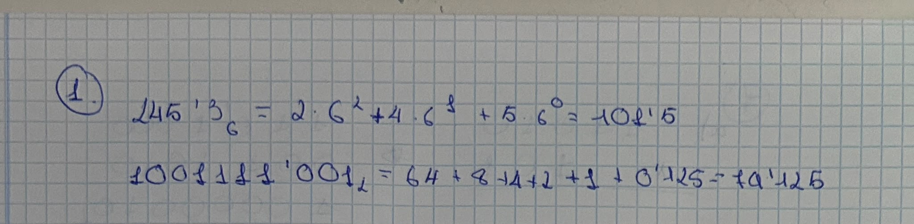
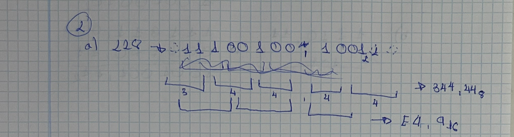
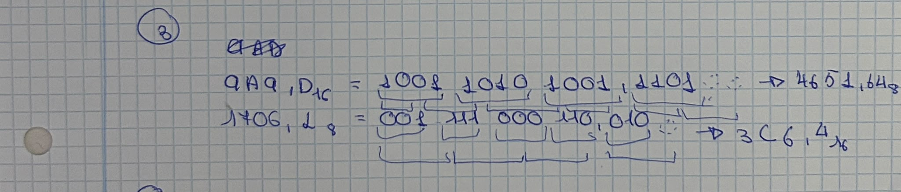
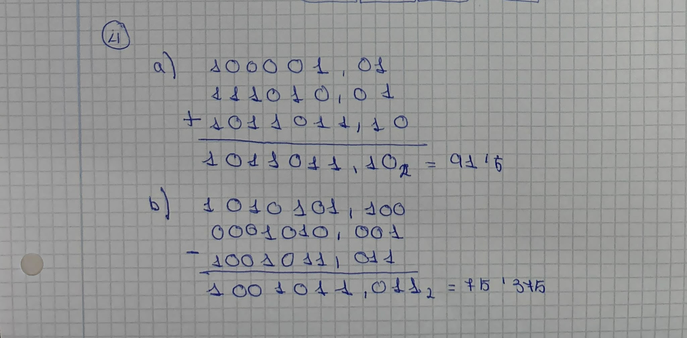
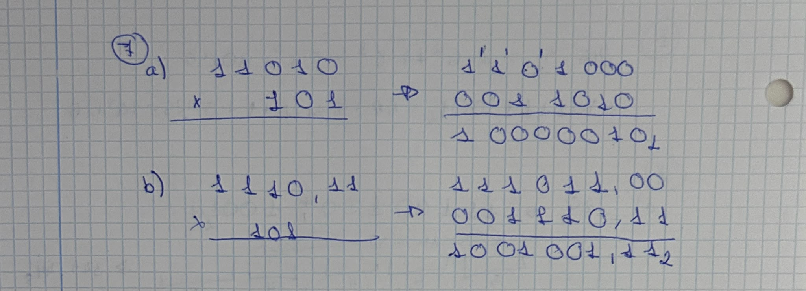
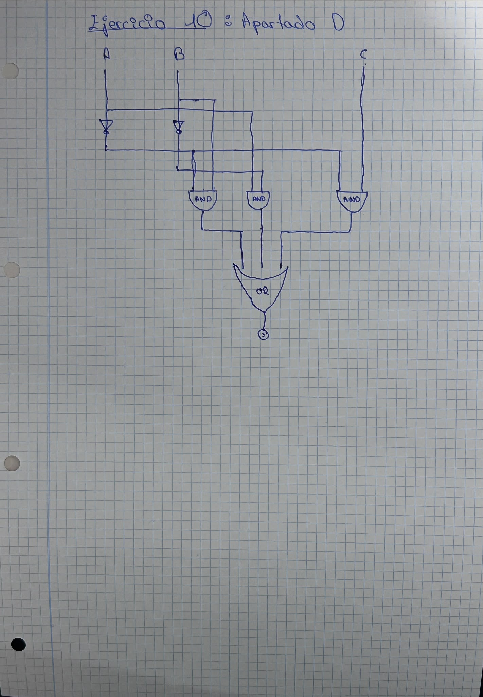

# Relacion de Ejercicios de Binario y de Puertas Logicas

> @autor: Marco

## Relacion 05

### Ejercicio 1

- Apartado a: 245,3 en base 6 es 101,5 en decimal. Cada cifra se multiplica por 6 elevado a su posición:

  2 x 6 al cuadrado = 72, 4 x 6 = 24, 5 x 1 = 5 y 3 x 6 a la menos 1 = 0,5. Sumo: 72 + 24 + 5 + 0,5 = 101,5

- Apartado b: 1001111,001 en base 2 es 79,125 en decimal. Solo cuentan las cifras que valen 1:

  64 + 8 + 4 + 2 + 1 + 0,125 = 79,125

### Ejercicio 2

- Apartado a: 228,5625 es 11100100,1001 en binario, 344,44 en octal y E4,9 en hexadecimal.

  Con el método de las bombillas, enciendo la bombilla si su peso cabe en lo que me queda por representar y se lo resto. Si no cabe, la dejo apagada.

  Parte entera (228): la 128 cabe y quedan 100, la 64 cabe y quedan 36, la 32 cabe y quedan 4, la 16 y la 8 no caben, la 4 cabe y quedan 0, y la 2 y la 1 quedan apagadas. Las bombillas de 128 a 1 son 1 1 1 0 0 1 0 0, es decir 11100100.

  Parte fraccionaria (0,5625): la 0,5 cabe y quedan 0,0625, la 0,25 y la 0,125 no caben, y la 0,0625 cabe y quedan 0. Las bombillas son 1 0 0 1, es decir 1001.

  Resultado en binario: 11100100,1001

  Octal, agrupando de 3 en 3 desde la coma: 011 100 100 , 100 100 = 344,44

  Hexadecimal, agrupando de 4 en 4 desde la coma: 1110 0100 , 1001 = E4,9

- Apartado b: 23,6 es 10111,100110 en binario con 6 bits fraccionarios. No es exacto.

  Parte entera: 23 = 16 + 4 + 2 + 1 = 10111.

  Parte fraccionaria, multiplicando por 2 y quedándome con la parte entera:

  - 0,6 x 2 = 1,2, bit 1
  - 0,2 x 2 = 0,4, bit 0
  - 0,4 x 2 = 0,8, bit 0
  - 0,8 x 2 = 1,6, bit 1
  - 0,6 x 2 = 1,2, bit 1
  - 0,2 x 2 = 0,4, bit 0

  No es exacto porque 0,6 se repite sin fin en binario (0,1001 1001...). Lo que realmente se guarda es 23 + 38/64 = 23,59375, así que el error es 23,6 - 23,59375 = 0,00625.

### Ejercicio 3

- Apartado a: 9A9,D en hexadecimal es 4651,64 en octal.

  Paso a binario cada cifra con 4 bits: 9 = 1001, A = 1010, 9 = 1001 y D = 1101, así que queda 100110101001,1101. Agrupo de 3 en 3 desde la coma: 100 110 101 001 , 110 100 = 4651,64

- Apartado b: 1706 en octal es 3C6 en hexadecimal.

  Paso a binario cada cifra con 3 bits: 1 = 001, 7 = 111, 0 = 000 y 6 = 110, así que queda 001111000110. Agrupo de 4 en 4 desde la derecha: 0011 1100 0110 = 3C6

### Ejercicio 4

- Apartado a: 100001,01 + 111010,01 = 1011011,10

  Sumo de derecha a izquierda llevándome 1 cuando 1 + 1 da 10. Hay acarreo en los bits de la parte fraccionaria y también al final, que añade el 1 de la izquierda. En decimal es 33,25 + 58,25 = 91,5.

- Apartado b: 1010101,1 - 1010,001 = 1001011,011

  Igualo los decimales (1010101,100 - 0001010,001) y resto de derecha a izquierda pidiendo prestado cuando hace falta. En decimal es 85,5 - 10,125 = 75,375.

### Ejercicio 5

- Apartado a: -72 en 8 bits.

  72 = 01001000.

  - Signo y magnitud: 11001000
  - Complemento a 1: 10110111 (invierto los bits)
  - Complemento a 2: 10111000 (complemento a 1 más 1)

- Apartado b: 106 - 107 = -1 en complemento a 2.

  106 = 01101010 y 107 = 01101011. Complemento a 2 de 107: invierto (10010100) y sumo 1 (10010101).

  01101010 + 10010101 = 11111111. Empieza por 1, así que es negativo, y su valor es -1.

- Apartado c: 44 + 28 = 72.

  00101100 + 00011100 = 01001000. No hay desbordamiento porque sumo dos positivos, el resultado es positivo y 72 cabe en 8 bits (el rango va de -128 a 127).

- Apartado d: (-106) + 107 = +1 en signo y magnitud.

  -106 = 11101010 y 107 = 01101011. Con signos distintos se restan las magnitudes (107 - 106 = 1) y el resultado lleva el signo del número de mayor magnitud, que es 107 (positivo). Resultado: 00000001.

### Ejercicio 6

- Solución: 2,25 - 3,25 = 1111,0000, que es -1.

  2,25 = 0010,0100 y 3,25 = 0011,0100. Complemento a 2 de 3,25: invierto (1100,1011) y sumo 1 al último bit (1100,1100).

  0010,0100 + 1100,1100 = 1111,0000. Empieza por 1, así que es negativo, y su valor es -1.

### Ejercicio 7

- Apartado a: 11010 x 101 = 10000010, que es 130.

  101 tiene unos en las posiciones 2 y 0, así que sumo 11010 desplazado 2 posiciones (1101000) y 11010 sin desplazar (0011010).

  1101000 + 0011010 = 10000010

- Apartado b: 1110,11 x 101 = 1001001,11

  Multiplico sin la coma (111011 x 101): 11101100 + 00111011 = 100100111. Después coloco la coma dejando 2 decimales: 1001001,11 (73,75).

- Apartado c: tomo 10110101 sin signo (181).

  Desplazado 2 posiciones a la izquierda con 10 bits queda 1011010100. Es multiplicar por 4 (724) y no se pierde nada.

  Desplazado 3 posiciones a la derecha queda 00010110. Es dividir entre 8 y quedarse con la parte entera (181 / 8 = 22,6 y queda 22). Se pierden los 3 bits de la derecha (101).

### Ejercicio 8

- Solución: Windows calcula en GiB (1 GiB = 1.073.741.824 bytes), no en GB decimales.

  500.000.000.000 / 1.073.741.824 = 465,66, que es lo que muestra Windows.

  La diferencia es 500 - 465,66 = 34,34, y 34,34 / 500 = 0,0687, es decir un 6,87 %.

  Vídeos de 1,5 GiB: 465,66 / 1,5 = 310,44, así que caben 310.

### Ejercicio 9

- Solución: la puerta de arriba es una NOR de A y B (la llamo P), la de abajo es una NOT de C (la llamo Q) y la última es una OR de P y Q. Entonces S = NOT (A OR B) OR NOT C.

  Tabla de verdad con las salidas intermedias:

  - A=0, B=0, C=0: P=1, Q=1, S=1
  - A=0, B=0, C=1: P=1, Q=0, S=1
  - A=0, B=1, C=0: P=0, Q=1, S=1
  - A=0, B=1, C=1: P=0, Q=0, S=0
  - A=1, B=0, C=0: P=0, Q=1, S=1
  - A=1, B=0, C=1: P=0, Q=0, S=0
  - A=1, B=1, C=0: P=0, Q=1, S=1
  - A=1, B=1, C=1: P=0, Q=0, S=0

  S vale 1 en ABC = 000, 001, 010, 100 y 110.

### Ejercicio 10

- Apartado a: S vale 1 en las combinaciones 1, 2, 3, 4 y 5.

  - 0 (A=0, B=0, C=0): S=0
  - 1 (A=0, B=0, C=1): S=1
  - 2 (A=0, B=1, C=0): S=1
  - 3 (A=0, B=1, C=1): S=1
  - 4 (A=1, B=0, C=0): S=1
  - 5 (A=1, B=0, C=1): S=1
  - 6 (A=1, B=1, C=0): S=0
  - 7 (A=1, B=1, C=1): S=0

- Apartado b: un término por cada combinación en la que S vale 1.

  S = (NOT A AND NOT B AND C) OR (NOT A AND B AND NOT C) OR (NOT A AND B AND C) OR (A AND NOT B AND NOT C) OR (A AND NOT B AND C)

- Apartado c: en el mapa de Karnaugh, la fila A=0 vale 0, 1, 1, 1 y la fila A=1 vale 1, 1, 0, 0 (columnas BC = 00, 01, 11, 10). Agrupo:

  - Casillas 2 y 3: NOT A AND B
  - Casillas 4 y 5: A AND NOT B
  - Casillas 1 y 3: NOT A AND C

  S = (NOT A AND B) OR (A AND NOT B) OR (NOT A AND C)

- Apartado d: el circuito lleva 2 puertas NOT (una en A y otra en B), 3 puertas AND y una OR de 3 entradas.

  - Una AND con NOT A y B
  - Una AND con A y NOT B
  - Una AND con NOT A y C
  - La OR recibe las tres AND y su salida es S

### Fecha

09/10/2026
